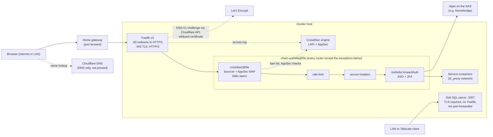
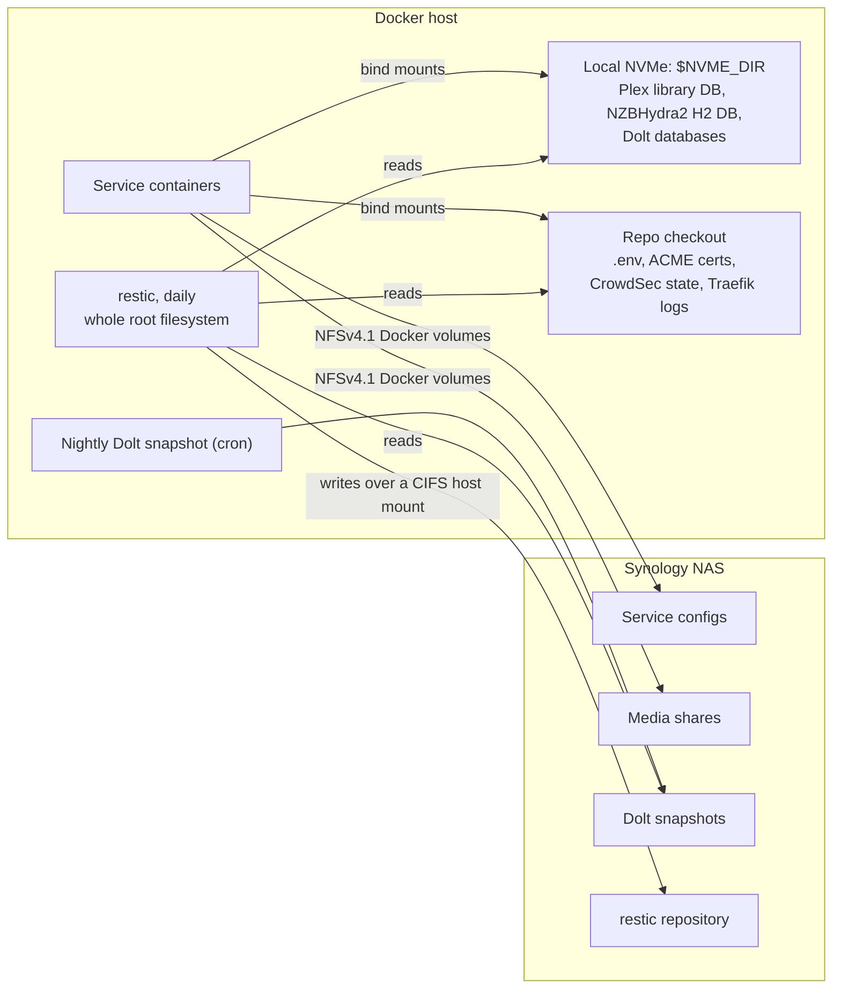
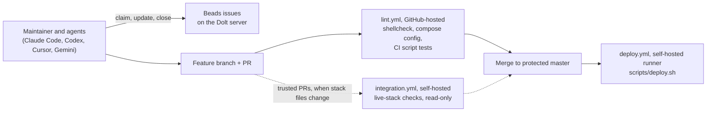

# Home Server Docker Stack

This repo is the live configuration of a single-host homelab: 22 Docker Compose services on one Ubuntu 24.04 server,
with a Synology NAS for configs, media and backups. Every compose-defined web service is routed through Traefik, a
CrowdSec WAF and Authelia SSO/2FA. A merge to `master` is a deploy: GitHub-hosted CI checks each PR, and a
self-hosted runner on the server applies the merged commit ([docs/DEPLOY.md](docs/DEPLOY.md)). The work is done by
the maintainer and by AI coding agents (Claude Code, Codex, Cursor, Gemini) that share one rule file,
[AGENTS.md](AGENTS.md), and coordinate through
[Beads](https://github.com/gastownhall/beads) issues on a Dolt server that runs in this stack. The goal is that a total
loss can be rebuilt from this repo, the backups and written docs alone; [REBUILD.md](REBUILD.md) is that runbook, and
its §8 lists the gaps still open.

## Architecture

### Request path



- **Chains.** Every chain starts with `crowdsec@file`, then rate limiting and secure headers
  ([traefik-rules/middleware-chains.yml](traefik-rules/middleware-chains.yml)). `chain-authelia` adds Authelia;
  `chain-no-auth` and `chain-basic-auth` are defined as variants, but no router uses them today (Beads ds-2xi tracks
  the unused basic-auth one).
- **Fail open, on purpose.** If CrowdSec's LAPI or AppSec is down, traffic passes and Authelia is still the auth
  layer; a wrong bouncer key blocks instead ([docs/CROWDSEC.md](docs/CROWDSEC.md)).
- **Known exceptions.** The `:80` catch-all router only redirects to HTTPS (no backend). The NAS admin UI is behind TCP
  TLS-passthrough routers, which the HTTP WAF cannot inspect, and one NAS photo router has no chain; both are tracked
  in [REBUILD.md](REBUILD.md) §8 (ds-0lu, ds-o9h).
- **No host addresses in compose.** Ports publish on every host address; access is limited by what the gateway
  forwards, the tailnet ACL, and TLS plus auth in each service ([AGENTS.md](AGENTS.md) hard rule 4).

### Storage and backups



- **Two NAS protocols.** Containers reach the NAS through NFS Docker volumes declared in compose. The host also
  mounts ten NAS shares over CIFS (`/etc/fstab`) for host-side access, such as the restic repository
  ([REBUILD.md](REBUILD.md) §3).
- **Why some data is local.** The NAS periodically revokes NFSv4 lock state, the kernel surfaces that as `EIO`, and
  NZBHydra2's H2 database never recovers, so its database sits on the NVMe. Plex's library database is local for
  performance; Dolt's data is local too ([REBUILD.md](REBUILD.md) §5).
- **Backups.** restic backs up the host's whole root filesystem (including every `$NVME_DIR` path and the checkout's
  gitignored state) to a repository on the NAS, daily, with a weekly `restic check`. The live Dolt directory is
  excluded; the nightly snapshot on the NAS is included instead. Service configs and media are covered by the NAS
  itself ([REBUILD.md](REBUILD.md) §6). The restic repository lives on the NAS it backs up; a second copy is a
  separate open issue.

### Change flow



`deploy.sh` fast-forwards the deploy checkout to the merged commit, refuses to run if Dolt's NAS config has drifted
from its template or NVMe data is still at a legacy path, then runs `docker compose up -d --build --remove-orphans`
and restarts Traefik when its file rules changed ([docs/DEPLOY.md](docs/DEPLOY.md)).

## Tech

- **Host:** Ubuntu 24.04, Docker 29 with Compose v5; Tailscale for off-LAN clients of services that are not
  port-forwarded, such as Dolt
- **Edge:** Traefik 3.6 (Docker and file providers), Let's Encrypt wildcard certificate via Cloudflare DNS-01
- **Security:** CrowdSec 1.8 with the vendored Traefik bouncer plugin and AppSec, Authelia SSO/2FA, a Docker socket
  proxy (no container other than the socket proxy gets the Docker socket directly)
- **Storage:** Synology NAS over NFSv4.1 (containers) and CIFS (host), local NVMe for embedded databases, restic
- **Apps:** Plex, Sonarr, Radarr, Bazarr, SABnzbd, NZBHydra2, Kometa, Calibre-Web, LazyLibrarian, Home Assistant and
  more (table below)
- **Delivery:** GitHub Actions (GitHub-hosted lint and tests, self-hosted deploy), ShellCheck
- **Agents:** Beads issue tracking on a shared Dolt 2.6 server, one `AGENTS.md` for every coding agent

## Docs

| Doc | What |
|---|---|
| [REBUILD.md](REBUILD.md) | Fresh-host rebuild: what is not in the repo, mounts, NVMe paths, backups, bring-up |
| [docs/DEPLOY.md](docs/DEPLOY.md) | How merge-to-deploy works, its security model, integration tests, rollback |
| [docs/CROWDSEC.md](docs/CROWDSEC.md) | The WAF: how it is wired, why it fails open, how to operate it |
| [docs/decisions/](docs/decisions/) | Architecture decision records |
| [docs/incidents/](docs/incidents/) | Sanitized incident write-ups |
| [dolt/README.md](dolt/README.md) | The Dolt server behind Beads |
| [AGENTS.md](AGENTS.md) | Rules for AI coding agents |

## Roadmap

Planned, not built yet. Tracked in Beads under the epic ds-nhh; the first decision is
[ADR 0001](docs/decisions/0001-public-private-split.md).

1. **Public platform, private instance.** Move instance values out of this repo into a private one, with secrets in
   SOPS + age (ds-nhh.3, ds-nhh.5). Deploys then run from the private repo, triggered by a dispatch from this one
   (ds-nhh.5.7).
2. **Ansible.** Describe the current host as it is, then prove it with a disaster-recovery drill on a fresh VM
   (ds-nhh.4).
3. **Proxmox, then k3s.** A Proxmox host and a k3s cluster managed with GitOps (ds-nhh.7).

---

## References

- [Traefik Docker tutorial](https://www.smarthomebeginner.com/traefik-2-docker-tutorial/)
- [Traefik docs](https://doc.traefik.io/traefik/)
- [Docker Compose reference](https://docs.docker.com/compose/compose-file)

## Services

| Category | Service | Subdomain |
|----------|---------|-----------|
| Infrastructure | Traefik | `traefik.$DOMAINNAME` |
| Infrastructure | Authelia | `authelia.$DOMAINNAME` |
| Infrastructure | Portainer | `portainer.$DOMAINNAME` |
| Infrastructure | Docker Socket Proxy | internal only |
| Infrastructure | CrowdSec (WAF) | internal only |
| Infrastructure | Task Scheduler | internal only |
| Infrastructure | Dolt (Beads) | `dolt.$DOMAINNAME:3307` on LAN and Tailscale, TLS only, no Traefik |
| Dashboard | Organizr | `start.$DOMAINNAME` |
| Media | Plex | `plex.$DOMAINNAME` |
| Media | Sonarr | `sonarr.$DOMAINNAME` |
| Media | Radarr | `radarr.$DOMAINNAME` |
| Media | Bazarr | `bazarr.$DOMAINNAME` |
| Media | SABnzbd | `sabnzb.$DOMAINNAME` |
| Media | NZBHydra2 | `hydra.$DOMAINNAME` |
| Collection Mgmt | Kometa | internal only (no web UI) |
| Books | Calibre-Web | `books.$DOMAINNAME` |
| Books | Lazy Librarian | `lazylib.$DOMAINNAME` |
| Home Automation | Home Assistant | `homeassistant.$DOMAINNAME` |
| Utilities | iSponsorBlockTV | internal only |
| Utilities | LibreSpeed | `speedtest.$DOMAINNAME` |
| Utilities | Smokeping | `smokeping.$DOMAINNAME` |
| Utilities | Slideshow Updater | internal only |

## Setup

### 1. Environment

```bash
cp env.example .env
# Fill in all values in .env
```

Key variables:

| Variable | Purpose |
|----------|---------|
| `DOMAINNAME` | Primary domain; every service is a subdomain |
| `CLOUDFLARE_EMAIL` | Let's Encrypt account email (ACME registration) |
| `CLOUDFLARE_DNS_API_TOKEN` | DNS challenge token from the "Edit zone DNS" template, scoped to `DOMAINNAME`'s zone only (below). Reaches Traefik as the compose secret `cloudflare_dns_api_token` (`CF_DNS_API_TOKEN_FILE`). Never the Global API Key |
| `CLOUDFLARE_ZONEID` | Zone ID (not referenced by compose) |
| `DOCKERDIR` | NFS mount path (e.g. `/mnt/docker`) |
| `LOCALDOCKERDIR` | The repo checkout (`/home/jalance/Projects/docker-services`, under `/home`, on the NVMe since 2026-11-07; `REBUILD.md` §5). Holds the gitignored local state: `acme/`, `crowdsec/`, `traefik-logs/` |
| `NVME_DIR` | Optional. Parent of the local NVMe paths `$NVME_DIR/<service>/<role>` (default `/usr/local/docker`, on `/`; `REBUILD.md` §5). Not `LOCALDOCKERDIR` |
| `SYNOLOGYDIR` | Synology NAS mount |
| `CROWDSEC_BOUNCER_KEY` | Traefik↔CrowdSec bouncer key (`openssl rand -hex 32`). Passed to both as the compose secret `crowdsec_bouncer_key`; CrowdSec registers it as bouncer `traefik` ([docs/CROWDSEC.md](docs/CROWDSEC.md)) |
| `DOLT_BEADS_PASSWORD` | Password for the Dolt user `beads` (`openssl rand -hex 32`, hex only). Compose secret `dolt_beads_password`, not a container env var |
| `PLEX_TOKEN` | Plex auth token (used by Kometa; from Plex account settings) |
| `TMDB_API_READ_ACCESS_TOKEN` | TMDb v4 read token (used by Kometa) |
No host addresses (LAN or Tailscale IP) are in `.env` or compose: no service binds one (`AGENTS.md` hard rule 4).

#### Cloudflare DNS token (`CLOUDFLARE_DNS_API_TOKEN`)

Traefik uses this token to create the temporary `_acme-challenge` TXT record that proves domain ownership to
Let's Encrypt (wildcard cert, renewed ~30 days before expiry). It needs DNS edit on one zone and nothing else.
Do **not** use the Global API Key: it has full control of the whole Cloudflare account.

To create (or replace a lost) token:
1. Cloudflare dashboard → **My Profile → API Tokens → Create Token** → template **Edit zone DNS** → Use template.
2. **Permissions:** leave as `Zone / DNS / Edit`.
3. **Zone Resources:** `Include` → `Specific zone` → your `DOMAINNAME` zone.
4. Leave Client IP filtering and TTL empty (an expiring token silently breaks renewal months later) → Continue → Create Token.
5. Copy the value into `.env` as `CLOUDFLARE_DNS_API_TOKEN=`. Cloudflare shows it only once; if lost, roll or recreate it.
6. When replacing a token, delete the old one under My Profile → API Tokens.

Verify before starting Traefik (expect `"status":"active"` and only your zone listed):
```bash
# Read only this variable: sourcing .env breaks in zsh (it sets names zsh treats as special, e.g. GID)
T=$(grep '^CLOUDFLARE_DNS_API_TOKEN=' .env | cut -d= -f2-)
curl -s -H "Authorization: Bearer $T" https://api.cloudflare.com/client/v4/user/tokens/verify | jq -c '{success, status: .result.status}'
curl -s -H "Authorization: Bearer $T" https://api.cloudflare.com/client/v4/zones | jq -c '[.result[].name]'
```

Compose refuses to start if the variable is empty. The token reaches Traefik as the compose secret
`cloudflare_dns_api_token` (`CF_DNS_API_TOKEN_FILE`), not as an env var. A bad token does not show up at startup,
only as a failed renewal in `docker compose logs traefik`.

### 2. Docker Networks

Both are external, so create them before the first run:
- `t2_proxy` (192.168.90.0/24): Traefik and every web-accessible service
- `socket_proxy` (192.168.91.0/24): isolated, Docker Socket Proxy only. No container other than the socket
  proxy gets the Docker socket directly, and CrowdSec has no Docker API access at all

```bash
docker network create --gateway 192.168.90.1 --subnet 192.168.90.0/24 t2_proxy
docker network create --gateway 192.168.91.1 --subnet 192.168.91.0/24 socket_proxy
```

### 3. Traefik

```bash
touch acme/acme.json
chmod 600 acme/acme.json
```

### 4. Kometa

Copy and configure the Kometa config on your NFS mount:
```bash
mkdir -p /mnt/docker/kometa/assets
cp kometa/config.yml.example /mnt/docker/kometa/config.yml
```

Token values are read from environment — no edits needed if `.env` is populated.

### 5. Portainer

After first start: Settings → Environments → Add Environment → Docker → set URL to `socket-proxy:2375`.

### 6. Start Everything

```bash
docker compose up -d
```

## Maintenance

Task Scheduler handles routine maintenance automatically:
- **Nightly at midnight**: Docker cleanup (prunes images/containers/volumes older than 7 days)
- **Sundays at 3 AM**: Plex restart (picks up `VERSION=public` updates)
- **Daily at 00:10**: Traefik access log rotation (current file + 2 rotated kept)
- **Daily at 00:20**: Dolt certificate dump; Dolt restarts only when the cert changed
- **Daily at 03:00** (jalance's crontab, `CRON_TZ=America/Denver`): `scripts/dolt-prebackup.sh` overwrites a consistent snapshot on the NAS at `/mnt/docker/dolt/backups`
- **Daily at 1 AM**: Kometa runs and updates Plex collections

## Service notes

- **Plex**: LinuxServer.io image with `/dev/dri` GPU transcoding; `VERSION=public` updates it on every container
  restart. Its library database is on the local NVMe and in no backup (`REBUILD.md` §5-6).
- **Kometa**: runs daily at 1 AM; reads `PLEX_TOKEN` and `TMDB_API_READ_ACCESS_TOKEN` from the env; config at
  `/mnt/docker/kometa/config.yml` (template `kometa/config.yml.example`).
- **Home Assistant**: privileged, host network (needed for device access).
- **NZBHydra2**: its H2 database is on the local NVMe, not NFS (`REBUILD.md` §5).
- **Logging**: every container uses `*default-logging` (json-file, 10MB max, 3 files). Application logs on NFS rotate
  themselves; do not add an external logrotate. Exception: Traefik's access log (`REBUILD.md` §7).
- **CrowdSec WAF** and the Traefik file rules: [docs/CROWDSEC.md](docs/CROWDSEC.md).

## Dolt (Beads)

Shared Dolt sql-server for `bd` on several machines. Not behind Traefik. Its config lives on the NAS; `dolt/` holds
templates. Details: [dolt/README.md](dolt/README.md), restore: [dolt/RESTORE.md](dolt/RESTORE.md).

## Adding a service

1. Copy an existing service in `docker-compose.yml` (e.g. `smokeping` or `radarr`), keeping `logging: *default-logging`
   and `security_opt: no-new-privileges:true`. Join the `t2_proxy` network.
2. Labels:
   ```yaml
   - "traefik.enable=true"
   - "traefik.http.routers.<name>-rtr.entrypoints=https"
   - "traefik.http.routers.<name>-rtr.rule=Host(`<name>.$DOMAINNAME`)"
   - "traefik.http.routers.<name>-rtr.tls=true"
   - "traefik.http.routers.<name>-rtr.middlewares=chain-authelia@file"
   - "traefik.http.routers.<name>-rtr.service=<name>-svc"
   - "traefik.http.services.<name>-svc.loadbalancer.server.port=<port>"
   ```
3. Config persistence: an NFS volume (follow the existing pattern). If it needs the local NVMe instead (an embedded
   database, or speed), mount `${NVME_DIR:-/usr/local/docker}/<service>/<role>` and add a row to `NVME_PATHS` in
   `scripts/lib/nvme-paths.sh` (`./scripts/ci/test-nvme-paths.sh` fails until both agree).
4. New required variables: `AGENTS.md` hard rule 7 (a dummy value in `.github/workflows/lint.yml` and a line in
   `env.example`).
5. Add the subdomain to `SERVICES` in `scripts/validate-traefik.sh` and a row to the Services table above.
6. After the deploy, run `./scripts/validate-traefik.sh`.

## Development

Changes go through a feature branch and a PR; a merge to `master` deploys ([docs/DEPLOY.md](docs/DEPLOY.md)).
Agent instructions (Claude Code, Codex, Cursor, Gemini): [AGENTS.md](AGENTS.md). Open work is tracked in Beads
(`bd ready`), on the shared Dolt server, not in markdown TODO files.
